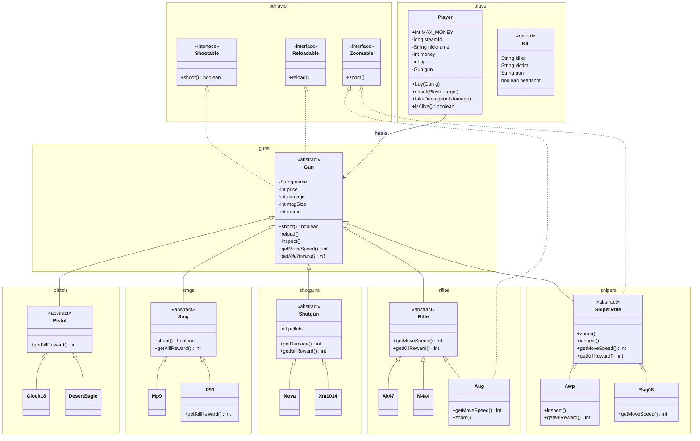

# Detailed design: mini-CS2

This is the **detailed design** of a small console version of Counter-Strike 2.
In the V-model it comes right before **coding**: first we decide which classes, fields and rules exist, then we write the code.
Your homework `DESIGN.md` should look like this file.

## 1. What the program does

- Players buy guns, shoot each other and get money for a kill.
- Every gun has a name, a price, damage and a magazine. Different kinds of guns shoot and reward differently.
- The program runs in the console: `Main` plays one short round.

Numbers are close to CS2 but simplified: no armor, no distance, no headshots.

## 2. Packages

One package = one group of classes that belong together. The package name is the folder path.

| Package | What lives there |
|---|---|
| `md.bsf.cs2` | `Main`: starts the game |
| `md.bsf.cs2.behavior` | Interfaces: what an object **can do** (`Shootable`, `Reloadable`, `Zoomable`) |
| `md.bsf.cs2.guns` | `Gun`: what **every** gun has |
| `md.bsf.cs2.guns.pistols` | `Pistol` and the real pistols |
| `md.bsf.cs2.guns.smgs` | `Smg` and the real SMGs |
| `md.bsf.cs2.guns.shotguns` | `Shotgun` and the real shotguns |
| `md.bsf.cs2.guns.rifles` | `Rifle` and the real rifles |
| `md.bsf.cs2.guns.snipers` | `SniperRifle` and the real sniper rifles |
| `md.bsf.cs2.player` | `Player` and the `Kill` record |
| `md.bsf.cs2.examples` | Small programs from the lesson (`Lookup`, `Procedural`) |

## 3. Class diagram

GitHub draws this diagram from the text below. Each frame is a package (short name).



The same diagram as a picture: [docs/class-diagram.png](docs/class-diagram.png).

## 4. Classes and rules

### Interfaces (`behavior`): what an object can do

| Interface | Method | Meaning |
|---|---|---|
| `Shootable` | `boolean shoot()` | Fire. Returns `true` if a bullet was fired |
| `Reloadable` | `void reload()` | Fill the magazine |
| `Zoomable` | `void zoom()` | Look through the scope |

### `Gun` (abstract): what every gun has

| Field | Type | Rule |
|---|---|---|
| `name` | `String`, `final` | not `null`, not blank |
| `price` | `int`, `final` | > 0 |
| `damage` | `int`, `final` | > 0 |
| `magSize` | `int`, `final` | > 0 |
| `ammo` | `int` | 0 … `magSize`; a new gun is full; changes **only** through `shoot()` and `reload()` |

| Method | Behaviour |
|---|---|
| `shoot()` | `ammo == 0` → prints `*click* - reload!`, returns `false`. Otherwise `ammo - 1`, prints `bang!`, returns `true` |
| `reload()` | `ammo = magSize` |
| `inspect()` | prints `<name>: looks at the gun` |
| `getMoveSpeed()` | 250 (default) |
| `getKillReward()` | **abstract**: every category decides |

Invalid constructor values → `IllegalArgumentException`. `Gun` is `abstract`: you can't buy "just a gun".

### Categories (abstract): what is typical for the group

| Class | Adds or overrides | Kill reward |
|---|---|---|
| `Pistol` | — | $300 |
| `Smg` | `shoot()` fires a burst of 3 bullets | $600 |
| `Shotgun` | field `pellets` (> 0); `getDamage()` = damage × pellets | $900 |
| `Rifle` | `getMoveSpeed()` = 215 | $300 |
| `SniperRifle` | implements `Zoomable`: `zoom()` x4; `inspect()` checks the scope; `getMoveSpeed()` = 200 | $300 |

### Real guns: only name and numbers

| Class | Extends | Name | Price | Damage | Magazine | Own overrides |
|---|---|---|---|---|---|---|
| `Glock18` | `Pistol` | Glock-18 | 200 | 30 | 20 | — |
| `DesertEagle` | `Pistol` | Desert Eagle | 700 | 53 | 7 | — |
| `Mp9` | `Smg` | MP9 | 1250 | 26 | 30 | — |
| `P90` | `Smg` | P90 | 2350 | 26 | 50 | kill reward $300 |
| `Nova` | `Shotgun` | Nova | 1050 | 26 × 9 pellets | 8 | — |
| `Xm1014` | `Shotgun` | XM1014 | 2000 | 20 × 6 pellets | 7 | — |
| `Ak47` | `Rifle` | AK-47 | 2700 | 36 | 30 | — |
| `M4a4` | `Rifle` | M4A4 | 3100 | 33 | 30 | — |
| `Aug` | `Rifle` | AUG | 3300 | 28 | 30 | implements `Zoomable` (x2); speed 220 |
| `Awp` | `SniperRifle` | AWP | 4750 | 115 | 5 | kill reward $100; `inspect()` spins the AWP |
| `Ssg08` | `SniperRifle` | SSG 08 | 1700 | 88 | 10 | speed 230 |

### `Player`

| Field | Type | Rule |
|---|---|---|
| `MAX_MONEY` | `static final int` | 16000, one for all players |
| `playersCreated` | `static int` | +1 at the **end** of the constructor |
| `steamId` | `long`, `final` | unique, never changes, no setter |
| `nickname` | `String` | 1–32 characters, not blank |
| `money` | `int` | 0 … `MAX_MONEY`; no public setter |
| `hp` | `int` | 0 … 100, starts at 100 |
| `gun` | `Gun` | **has a**: the player holds a gun, the player is not a gun |

| Method | Behaviour |
|---|---|
| `buy(Gun g)` | price > money → `IllegalArgumentException`, money unchanged. Otherwise pays and takes the gun |
| `shoot(Player target)` | the gun fires → target takes the gun's damage; target dies → shooter gets the kill reward (never more than `MAX_MONEY`) |
| `takeDamage(int damage)` | damage > 0, otherwise `IllegalArgumentException`; hp never below 0 |
| `isAlive()` | hp > 0 |
| `equals` / `hashCode` | by `steamId` only: nicknames repeat and change |
| `toString()` | `Player{nickname='zhenya', hp=100, money=400}` |

### `Kill` (record)

`killer`, `victim`, `gun`, `headshot`: one line of the kill feed. It happened and never changes, so it is a `record`, not a class.

## 5. Main scenario

1. zhenya and lera join with $800 each.
2. zhenya buys a Desert Eagle, lera buys a Glock-18.
3. zhenya shoots until lera is dead and gets $300.
4. zhenya reconnects (same `steamId`, new nickname): the scoreboard (`HashSet`) still has 2 players.
5. The last line is an invalid action: lera can't afford an AWP, so the program stops with an exception.

Expected output:

```
zhenya bought Desert Eagle, $100 left
lera bought Glock-18, $600 left
Desert Eagle: bang! [6/7]
  lera hp: 47
Desert Eagle: bang! [5/7]
  lera hp: 0
zhenya [Desert Eagle] lera  +$300
Player{nickname='zhenya', hp=100, money=400}
Player{nickname='lera', hp=0, money=600}
on scoreboard: 2
players created: 3
Kill[killer=zhenya, victim=lera, gun=Desert Eagle, headshot=false]
Exception in thread "main" java.lang.IllegalArgumentException: lera can't afford AWP: $600
```

## 6. Where each OOP principle is

| Principle | In this design |
|---|---|
| Encapsulation | All fields `private`; `ammo` and `money` change only through methods with rules |
| Abstraction | Interfaces `Shootable`, `Reloadable`, `Zoomable`; `abstract` `Gun` and categories |
| Inheritance | `Gun` → category → real gun, 3 levels |
| Polymorphism | `gun.getKillReward()` and `gun.shoot()` work differently for every gun; `Zoomable` for `SniperRifle` and `Aug` |
