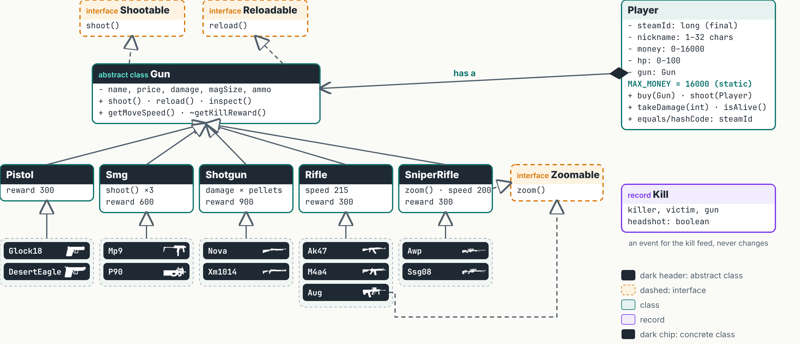

# OOP example: mini-CS2 in Java

The example for the lesson **OOP I** of the QA Automation Engineer course ([learning.bsf.md](https://learning.bsf.md)).
A small console Counter-Strike 2: guns are classes, their behaviour is interfaces, the player **has a** gun.

- [DESIGN.md](DESIGN.md): the detailed design (class diagram, packages, rules). **Start here.**
- [`src/main/java/md/bsf/cs2`](src/main/java/md/bsf/cs2): the code, written from that design.



## Project structure

The packages follow the diagram: one package per group of classes.

```
oop-cs2-example
├── pom.xml
├── DESIGN.md
└── src/main/java/md/bsf/cs2
    ├── Main.java                  ← one round of the game
    ├── behavior                   ← interfaces: what an object can do
    │   ├── Shootable.java
    │   ├── Reloadable.java
    │   └── Zoomable.java
    ├── guns
    │   ├── Gun.java               ← abstract: what every gun has
    │   ├── pistols                ← Pistol, Glock18, DesertEagle
    │   ├── smgs                   ← Smg, Mp9, P90
    │   ├── shotguns               ← Shotgun, Nova, Xm1014
    │   ├── rifles                 ← Rifle, Ak47, M4a4, Aug
    │   └── snipers                ← SniperRifle, Awp, Ssg08
    ├── player
    │   ├── Player.java            ← has a Gun
    │   └── Kill.java              ← record: one line of the kill feed
    └── examples
        ├── Lookup.java            ← "which method runs?" puzzle from the lesson
        └── Procedural.java        ← the same game without objects: why we need OOP
```

## Package rules

1. A package name is the folder path: `md/bsf/cs2/guns/rifles` → `package md.bsf.cs2.guns.rifles;` on the first line.
2. Names are lower case. They start with the domain reversed (`learning.bsf.md` → `md.bsf`), then the project (`cs2`).
3. One package = one group that belongs together: all rifles in `rifles`, all interfaces in `behavior`.
4. A class from another package needs an `import` (IntelliJ adds it with Alt+Enter) and must be `public`.
5. `protected` and package-private (no modifier) depend on packages: `Gun`'s `protected` constructor is open to `Rifle` in another package only because `Rifle` extends `Gun`.

## How to run

**IntelliJ IDEA:** File → Open → choose `pom.xml` → Open as Project. Open `Main.java` and press the green ▶ next to `main`.

**Terminal** (JDK 21 and Maven):

```bash
mvn -q compile
java -cp target/classes md.bsf.cs2.Main
```

Other programs: `md.bsf.cs2.examples.Lookup`, `md.bsf.cs2.examples.Procedural`.

## Notes

- Prices are from the CS2 buy menu. Damage, magazines, speeds and rewards are close to the game but simplified.
- Gun icons in the diagram: CS2 buy menu (Valve). Glock-18 and Desert Eagle are simple drawings.
